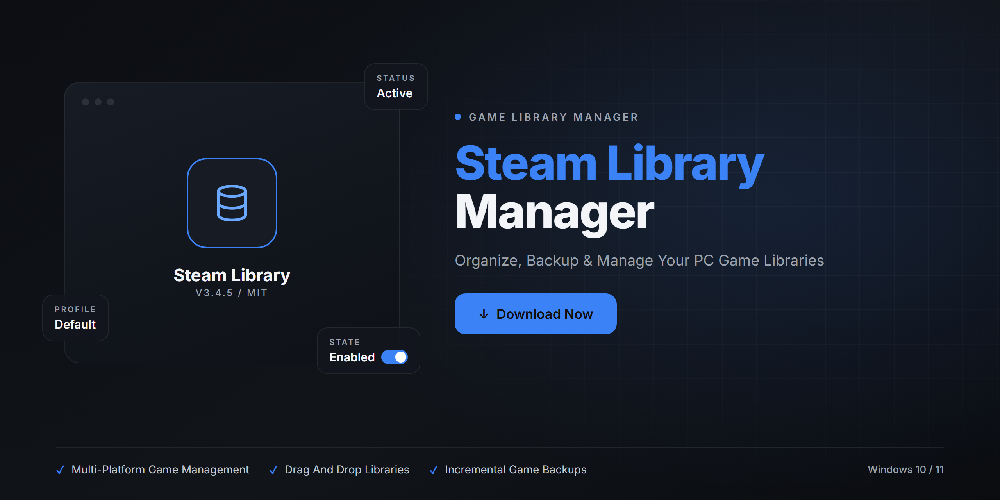
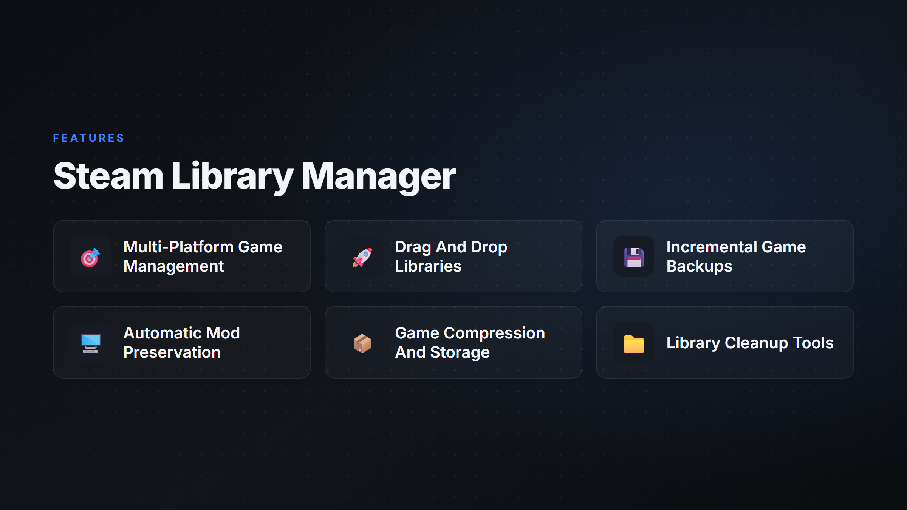

  
  
  
  
  
  

**Steam Library Manager is a free, open-source Windows desktop application for organizing, transferring, backing up and restoring PC game libraries.** Manage Steam, Origin and Uplay games from one convenient graphical interface without using the command line.

Take control of your game installations, organize multiple storage locations, protect your game files and keep your backups manageable with powerful library management tools.

## ⬇️ Installation

**Download the Windows application**

1. Open the repository's [Releases](https://github.com/olive527/steam-library-manager-windows/releases) page.
2. Download the latest release archive **`Steam Library Manager 4.0.4.zip`**.
3. Extract the archive into a folder of your choice.
4. Keep **`Steam Library Manager 4.0.4.exe`** and `libvlc.dll` together in that folder.
5. Double-click **`Steam Library Manager 4.0.4.exe`** to launch the application.

## ✨ Features

- 🎮 **Multi-Platform Game Management** — Organize games from Steam, Origin and Uplay in one Windows game library manager.
- 📚 **Multiple Game Libraries** — Manage installations across multiple drives, folders and storage locations without losing track of your collection.
- 🖱️ **Drag-and-Drop Transfers** — Move games and backup folders between supported library locations using an intuitive graphical interface.
- 💾 **Incremental Game Backups** — Update existing game backups without unnecessarily rebuilding entire archives from scratch.
- 🛡️ **Mod and Workshop Preservation** — Preserve associated game content, modifications and supported custom files alongside your game backups.
- 📦 **Game Compression** — Reduce storage requirements by compacting installed games and backup files.
- ♻️ **Backup Restoration** — Restore saved games and organize backup files using an accessible folder-based backup structure.
- 🧹 **Game Library Cleanup** — Identify unnecessary leftover files and clean up storage occupied by obsolete game data.
- ⚡ **Faster Backup Management** — Work with existing backup folders and manage game files without requiring every game client to remain running.
- 📂 **Accessible Backup Storage** — Keep game backups in an understandable file structure rather than relying exclusively on proprietary backup containers.

## 🖼️ Overview

Steam Library Manager brings essential PC gaming storage tools together in a straightforward Windows interface.

Whether you maintain a large Steam collection, use several game launchers or regularly move installations between drives, the application helps simplify everyday game library maintenance.

### 🎯 Why Use a Dedicated Game Library Manager?

| Capability | Benefit |
|---|---|
| Multiple libraries | Organize games across different drives |
| Incremental backups | Save time updating existing backups |
| File-based storage | Access backup contents directly |
| Compression | Make better use of disk space |
| Mod preservation | Keep supported additional game content |
| Cleanup | Remove unnecessary leftover files |
| Restoration | Recover games from saved backups |

### 💿 Manage Your Gaming Storage

Large PC games can consume substantial amounts of disk space. Managing multiple installations and backups manually can quickly become inconvenient.

Steam Library Manager provides practical tools to:

- Keep installations organized across storage devices.
- Maintain reusable copies of game files.
- Update backups as games change.
- Move game folders between supported locations.
- Reduce storage usage through compression.
- Keep additional game content with its associated backup.

## 🚀 Usage

Getting started with Steam Library Manager is straightforward.

1. **Open the application** after completing the installation.
2. **Locate your game libraries** and the supported game installations available on your computer.
3. **Organize your collection** by working with the available library and folder management features.
4. **Create game backups** to preserve installations and associated files.
5. **Update existing backups** when game files change instead of rebuilding everything unnecessarily.
6. **Move or restore games** using the library and backup management interface.
7. **Clean up storage** and compact files when additional disk space is needed.

### 🔄 Typical Game Backup Workflow

| Step | Action | Result |
|---|---|---|
| 1 | Select a game | Identify the installation |
| 2 | Choose a backup location | Organize saved files |
| 3 | Create a backup | Preserve game data |
| 4 | Update when needed | Maintain the existing backup |
| 5 | Restore when required | Recover saved game files |

### 🗃️ Supported Gaming Platforms

- **Steam** — Manage Steam game installations and backup folders.
- **Origin** — Organize supported Origin game libraries.
- **Uplay** — Manage supported Ubisoft Uplay game installations.

*Platform compatibility depends on the installed client, library configuration and application support.*

## 🔒 Security

Your game library and backup files should remain under your control.

Steam Library Manager is an open-source Windows application distributed under the MIT License.

- **No telemetry or tracking:** The application is designed as a local desktop utility, not an analytics platform.
- **Open-source code:** Inspect the source code and review how library and backup operations work.
- **Local file management:** Game organization and backup workflows operate on your computer.
- **Your storage, your choice:** Select appropriate library and backup locations on your own storage devices.
- **Report problems:** Use the GitHub Issues section to report reproducible bugs, compatibility problems or unexpected behavior.

### ⚠️ Important Notes

- Back up important data before performing large-scale file operations.
- Avoid modifying game folders while another application is actively updating them.
- Keep sufficient free disk space available when creating or restoring backups.
- Verify backup contents before removing original game installations.
- Game launcher updates and platform changes may affect compatibility.

### 🤝 Third-Party Compatibility

Steam Library Manager is an independent community software project.

It is not affiliated with, endorsed by, sponsored by or officially connected to Valve Corporation, Electronic Arts, Ubisoft or their respective game distribution platforms.

All third-party trademarks and product names belong to their respective owners.

## 📊 Game Library Research

Looking for information about PC games, release activity or game statistics?

Explore [SteamDB](https://steamdb.info/) and [Steam Charts](https://steamcharts.com/) for additional information about Steam games and player activity.

## 🛠️ Technology

The application is built around Windows desktop technologies.

| Component | Technology |
|---|---|
| Programming language | C# |
| Desktop interface | Windows Presentation Foundation (WPF) |
| Operating system | Microsoft Windows |
| Distribution | Open source |
| License | MIT |

## 💡 Who Is Steam Library Manager For?

This Windows game management utility is useful for:

- PC gamers with large Steam libraries.
- Players maintaining games across multiple hard drives.
- Users who want reusable game backups.
- Gamers who frequently reinstall or transfer games.
- Players who preserve mods and additional game content.
- Anyone looking for a free alternative to manual game backup management.

## 🗺️ Project Goals

The project focuses on making PC game storage easier to manage.

Its core goals are:

1. Simplify multi-library game organization.
2. Make game backups easier to create and maintain.
3. Reduce unnecessary backup storage requirements.
4. Preserve useful game-related files.
5. Provide a practical graphical alternative to manual file management.

## 📄 License

Steam Library Manager is released under the **MIT License**.

You are free to use, modify and distribute the software according to the terms of the license.

---

**Manage your PC game collection, protect your installations and make better use of your storage with Steam Library Manager.**